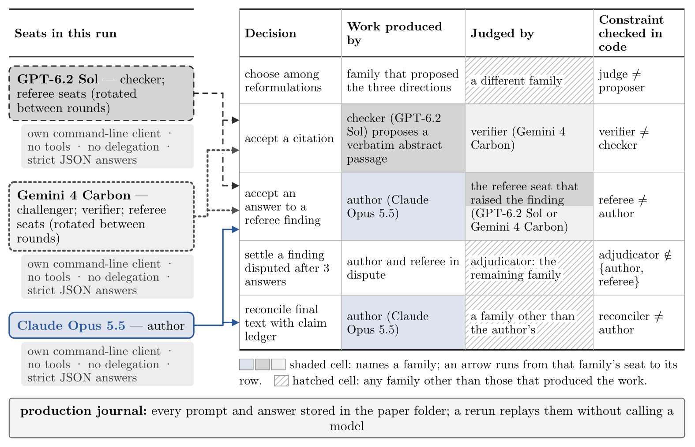

# Introduction

Galley is a semi-autonomous, multi-agent scholarly editor governed by cross-family separation of duties, a rule enforced in code that no model family judges its own output. We demonstrate it through one unattended run on one seed, the run that produced this manuscript, without a baseline system.

What sets very high-impact papers apart from the rest is not settled. Studies in computer science and in library and information science have linked citation outcomes to the authors' centrality in coauthorship networks [@yan2009applying; @sarigol2014predicting], a property of the authors rather than of the text. How a paper's content relates to its citation impact remains open.

A second gap separates a valuable idea from a paper ready to submit, and closing it with language models raises the question of who checks the work. Studies summarized by Chen et al. find that large language models serving as judges tend to favor their own responses over those generated by other models [@chen2025beyond], so a model that reviews its own draft does not provide an independent check. As a design precaution, Galley extends this separation from the individual model to its developer's model family.     

From a text seed, Galley produces a preprint package that is submission-ready under its own gates, not under any venue's requirements or external review. Galley requires only seven of its 27 behaviors for a paper to exist, and its final behavior, ready, checks only that Galley's internal gates hold on one revision. Whenever the text changes, the typeset behavior renders the manuscript as a PDF, a line-numbered review PDF, LaTeX, Word and an editor document, together with the evidence package and the sign-off sheet. The manuscript ends with its claim ledger and a production record generated from the run's journal that reports what each behavior did, and the journal itself is part of the package. The unattended run that produced this manuscript wrote each of these artifacts for its final revision.   

    

Our thesis is that a semi-autonomous scholarly editor can turn a raw text seed into a submission-ready preprint across isolated, replayable atomic behaviors, under a code-enforced rule that no model family judges its own output and with in-run checks auditing reliability on the manuscript's inputs. As a design choice, Galley relies on these in-run checks and keeps pre-deployment offline test suites minimal. Galley's unattended run producing this manuscript demonstrates this workflow on one seed.   Whether papers produced this way achieve high citation impact remains open.

The paper makes three contributions:

- **Cross-family separation of duties**: a rule enforced in code that no model family judges its own output. No family selects among its own reformulations, verifies its own citation passages, judges its own answers to referees, adjudicates its own disputes or reconciles its own final manuscript. Each family runs through its own command-line client with no tools and answers in a strict JSON schema, and every prompt and answer is stored in the paper's folder, so a rerun replays those recorded model exchanges without calling a model. 
- **In-run calibration**: diagnostic checks on a manuscript's own inputs that Galley uses as a design choice instead of extensive pre-deployment offline test suites. During claim-level citation verification, code checks that each proposed passage appears verbatim in the cited work's abstract. Once a run has verified citations, the calibrate behavior plants defective citations alongside unaltered controls and measures how many defects the verifier catches and how many controls it wrongly rejects. After peer review finishes, a family other than the author's reconciles the final text against every claim in the ledger.  
  

- **The Galley editor**: an open-source editor of 27 atomic behaviors that takes a text seed through impact review, evidence search and verification, drafting, referee rounds and reconciliation. A person can join at any point without being required, and the package records the standing and sources of every claim. 
 

Galley is released as `@autonomio/galley 0.1.0` under the MIT license, with source code at `https://github.com/autonomio/galley`.   

# Related Work

Galley draws on five bodies of work. These are multi-agent systems that automate parts of scholarly production, provenance tools for human–LLM co-writing, studies of fabricated citations, studies of self-preference in LLM evaluators, and two engineering practices: separation of duties and fault seeding. 

## Multi-agent systems for scholarly production

Agent systems already automate parts of scholarly production, including writing scientific surveys and checking that citations support the claims they are attached to [@yang2026deepsurvey]. DeepSurvey is a direct example. It models relationships across papers through clustering and comparative analysis. For reliability, it combines citation-graph expansion with hybrid filtering for topic-focused retrieval and constrains analysis and writing to evidence. It uses agentic refinement at several levels to check citation–claim alignment [@yang2026deepsurvey].

Galley shares DeepSurvey's concern with citation–claim alignment but checks it differently. Galley accepts a citation only when code confirms that its passage is copied verbatim from the cited work's abstract and a model family other than the one that proposed the passage judges that it supports the claim.

Agentic systems also write complete research papers. The AI Scientist generates research ideas, writes code, runs experiments, writes a full scientific paper and evaluates it with a simulated review process [@lu2024scientist]. The AI Scientist-v2 formulates hypotheses, runs experiments and writes manuscripts autonomously, and it produced an entirely AI-generated paper accepted through workshop peer review [@yamada2025scientistv2]. Galley also carries a person's seed text to a full manuscript, and it governs who evaluates that work: every judging seat goes to a model family other than the one that produced the work being judged.   

## Provenance in AI-assisted writing

 Prior HCI work on human–AI co-writing records the provenance of what an LLM generated in a document. HaLLMark visualizes the writer's interaction with an LLM; its authors argue that capturing the provenance of this interaction can help writers retain their agency, conform to policies and communicate their use of AI transparently to publishers and readers [@hoque2024hallmark]. DraftMarks marks AI-generated content within the final text with skeuomorphic traces such as masking tape or smudges, and computes collaboration metrics from writer–AI interaction data [@siddiqui2026draftmarks]. InkSync suggests executable edits within the document, warns authors when an edit introduces new information, helps them verify that information through external search and lets a third party audit the result through a trace of all generated content [@laban2024beyond].     

These tools record provenance at the level of the text and its edits. Galley records it at the level of claims and runs, in the claim ledger, evidence package, sign-off sheet and production journal (Sections 4 and 8). In threads the person shares with the agents, the agents' changes arrive as proposals the person accepts or declines.

## Fabricated citations

Large language models produce fabricated citations and real citations with substantive errors. Walters and Wilder found that 55% of GPT-3.5 citations and 18% of GPT-4 citations were fabricated, and that 43% of real GPT-3.5 citations and 24% of real GPT-4 citations contained substantive errors [@walters2023fabrication]. Misra and Udandarao note reported citation hallucination rates ranging from 18% in GPT-4 to over 70% in other frontier models [@misra2026detecting]. Lai et al. identified six recurring types of hallucination and found fabricated or inaccurate citations to be the most prevalent [@lai2026hallucinatio]. Linardon et al. checked 333 citation-claims against their cited sources: 19.8% were fabrications, 18.3% contained major errors, 18.3% contained minor errors and 43.5% were accurate [@linardon2026fluency]. These findings motivate pairing retrieval with a separate check that each cited passage supports the claim attached to it. 

## Self-preference in LLM evaluators

LLMs used as evaluators tend to rate their own outputs more favorably than outputs from other models. Panickssery et al. describe self-preference as an LLM evaluator scoring its own outputs higher than others' outputs even when human annotators judge them to be of equal quality [@panickssery2024llm]. Chen et al. summarize recent studies that find LLMs serving as judges favor their own responses over those generated by other models [@chen2025beyond]. Both works describe the preference of an individual model for its own outputs. A multi-agent pipeline could assign drafting and review to the same model under separate prompts, and that model would then evaluate its own output. Panels of evaluators drawn from disjoint model families have been used to judge model outputs, and they show less intra-model bias than a single large judge [@verga2024replacing]. Galley uses family disjointness for a different purpose. A model family is the line of models from one developer, and in Galley the family that judges a piece of work must differ from the family that produced it.

Family-level separation is a design precaution motivated by this evidence. At five governed decisions and in peer review (Sections 3 and 6)—from choosing among proposed directions to checking a claim-level citation passage and reconciling the final text—Galley assigns the judging seat to a family other than the one that produced the work. 

## Separation of duties and fault seeding

Separation of duties is a security principle that organizations have used extensively to prevent conflict of interest, fraud and error [@kugblenu2007separation]. Galley applies the principle to model families instead of people. Different model families hold the producing and evaluating seats.

 Mutation testing applies mutation operators to a program to create versions with few syntactic deviations, called mutants, and uses them to evaluate the adequacy of a test set [@andrade2019analyzing]. Ma et al. describe it as a well-established technique in traditional software testing that measures how far a test suite detects injected faults [@ma2018deepmutation]. The mutation score is the percentage of generated mutants that the suite kills [@hariri2018exploring]. Generating mutants by program allows systematic, repeatable seeding of many faults for statistical analysis, but whether results obtained this way lead to valid, representative conclusions remains open [@andrews2006using].

  

## The gap

Dividing drafting, reviewing and verifying into roles does not by itself separate the models that fill them. Without a rule on model families, one family can hold both the producing and the evaluating seat, and its model can then evaluate its own outputs, the condition under which self-preference has been described [@panickssery2024llm; @chen2025beyond].

Cross-family review applies separation of duties to the risk of self-preference in model evaluation. 

# Cross-Family Separation of Duties

Cross-family separation of duties is the rule, enforced in code rather than through role prompts, that no model family selects among its own reformulations, verifies its own citations, judges its own referee responses, adjudicates its own disputes or reconciles its own final manuscript. A model family is a line of language models from one developer. A seat is a role in a run, held by one model family: author, checker, challenger, verifier, referee or adjudicator. The rule therefore constrains which family may hold a judging seat for each of these five decisions.

## Five governed decisions

The rule governs five decisions, each a point at which one family's output is chosen, accepted or settled (Figure 1). The first is direction selection. A family other than the one that proposed the reformulations chooses among them. The second is claim-level citation verification. The checker proposes a passage for a claim, and the verifier, from a different family, judges whether the passage supports it. Citations from a model-run review (Section 5) instead enter the claim ledger through Canary's audit, in which an independent model audits every finding. The third is the judgment of referee responses. Referees from families other than the author's judge the author's responses. The fourth is adjudication. A family distinct from both the author's and the referee's adjudicates the dispute. The fifth is reconciliation. A family other than the author's reconciles the final manuscript.

Galley enforces the rule through seat assignment.  A judging step receives the work as input and returns its judgment. A prompt that asks a model to act as an independent reviewer leaves the reviewing family unchanged. Galley checks in code that the assigned family meets the rule for that decision.

## Seat assignment in this run

Galley runs several model families in separate seats. In this run, Claude Opus 5.5 held the author seat, GPT-6.2 Sol held the checker seat, and Gemini 4 Carbon held both the challenger and the verifier seats. Each referee was either GPT-6.2 Sol or Gemini 4 Carbon. For a finding under adjudication, the adjudicator came from the family distinct from both the author's and the referee's.  

## A governance pattern

Cross-family separation of duties, combined with in-run calibration (Section 7), is a governance pattern for multi-agent writing that has to stay tied to evidence. The separation constrains which families may judge work at each governed decision. In-run calibration consists of three checks in every run: code confirms that each claim-level citation quotes its source's abstract verbatim, the calibrate step plants defective citations and unaltered controls among the verified ones and measures how many the verifier catches, and reconciliation reads the final text against every claim in the ledger. Only the verifier's judgments are themselves measured; direction selection, referee-response judgment, adjudication and reconciliation rest on the separation alone. The separation and the checks together form a pattern that can be used without Galley's other components.

The pattern has two requirements. The first is at least three model families. Referees must come from a family other than the author's, and the adjudicator must come from neither the author's nor the referee's family. With two families, the referee takes the only non-author family, and no family remains from which to draw an adjudicator. Three families suffice because the rule holds for each decision against that decision's producer, not against every earlier seat. The referee and reconciliation seats therefore reuse the families that held the checker, verifier and challenger seats, and a citations referee comes from the family that proposed or verified the citations it reviews. The second requirement is a journal of prompts and answers. The journal preserves the prompts and answers for later inspection. Other evidence-bound writing systems can use the pattern to govern selection, verification, review, adjudication and reconciliation.

{#fig-fig1 width=95%}

# Architecture: Atomic Behaviors and the Ladder

Galley breaks the production of a manuscript, from seed to submission, into a ladder of 27 atomic behaviors. The seed is the only input a person must supply. Every later step, from reading the seed to marking the paper ready, is the work of one of these behaviors.

## Atomic behaviors

An atomic behavior is a unit of work that reads the paper's state, does one thing and writes its result. It does not know which behavior runs next.

We carried this design over from our earlier system, `autonomio/poise`, which we built for semi-autonomous software engineering. Galley applies the same design to a scholarly manuscript. Each unit of work stays small, and the order of work belongs to the scheduler, not to any behavior.

## The ladder and the scheduler

The ladder is the ordered list of the 27 atomic behaviors, in scan order: (1) `extract`, (2) `position`, (3) `review-idea`, (4) `reformulate`, (5) `select-direction`, (6) `literature-review`, (7) `analyze`, (8) `simulate`, (9) `plan`, (10) `outline`, (11) `find-evidence`, (12) `verify`, (13) `reassess`, (14) `calibrate`, (15) `draft`, (16) `figure`, (17) `fidelity`, (18) `frame`, (19) `referee`, (20) `close-round`, (21) `respond`, (22) `verify-disposition`, (23) `adjudicate`, (24) `reconcile`, (25) `reprofile`, (26) `typeset` and (27) `ready`. The scheduler scans the ladder from the top, runs whatever is ready, and scans again from the top whenever any behavior settles. Readiness, which the scheduler checks against the paper's state on each scan, decides whether a behavior runs, and position on the ladder decides which ready behavior a scan reaches first. After a behavior settles, the next scan can run a ready behavior higher on the ladder. When `respond` (21) answers a finding with a new claim that needs evidence, `find-evidence` (11) and `verify` (12) take that claim up before the author answers again, and no behavior needs to know that it must loop.

## Skeleton behaviors and improvers

Minor issues do not block work. Only the seven skeleton behaviors are required for a paper to exist: `extract` (1), `plan` (9), `outline` (10), `draft` (15), `frame` (18), `typeset` (26) and `ready` (27). The other twenty behaviors are improvers. An improver can make the paper better but cannot stop it, so small defects do not halt production.

## Isolated steps and the production journal

Each model family runs through its own command-line client with no tools and no delegation, and it answers in a strict JSON schema. Inside the step, the model does not search, run code or hand work to another agent.

Galley stores every prompt and answer in the paper's folder. We call this stored record the production journal. A rerun takes each model's answer from the journal instead of calling the model. The journal lets a reader inspect the run's recorded prompts and answers and replay its model exchanges step by step.

## Building the ladder one behavior at a time

We built the behaviors one at a time and showed each one working before we built the next. We continued until the chain of 27 behaviors covered the whole path from seed to submission.

{#fig-fig2 width=95%}

# From Seed to Verified Evidence

## Impact interrogation and reformulation

Before it writes any text, Galley screens the seed against a seven-factor impact standard, the authors' own design heuristic for how the paper should be written. Galley scores the seed on each factor, names the weakest factor and returns one of three verdicts: worth writing, reformulate, or no contribution. Like every improver, this screen can redirect the paper but cannot stop it. The same seven factors score the finished paper again. 

A reformulate verdict leads to exactly three directions. Galley proposes them. Each direction differs structurally from the other two, and each keeps the seed's explicit commitments.  Galley then chooses either the original idea or one of the three directions. A family other than the proposing family makes this choice. 

## Filling the gaps the argument needs

Once Galley selects a direction, it addresses gaps in the argument. Evidence search is the main route. Two further routes are optional, and both run on the authors' machine.

Galley can analyze the authors' data on their machine.  Galley can also run a simulation on the authors' machine.  

## Evidence search through Canary

Galley finds external evidence through Canary, the component it uses to search OpenAlex, a fully open index of scholarly works, authors, venues and institutions [@priem2022openalex; @priem2024openalex]. Galley's source, including its calls to Canary, is released under the MIT licence at https://github.com/autonomio/galley.   For each claim that needs external evidence, Galley writes search queries, runs them through Canary and considers up to a set number of candidate works. The run used a cap of 10 candidate works per claim. 

At the authors' request, Canary also reviews the literature in the background, in what we call a model-run review. The author writes a review question. A research model plans the search of OpenAlex, screens the candidates, reads their full texts and quotes the passage behind each finding, and an independent model audits every finding. Each upheld finding joins the claim ledger and the evidence package with its quoted passage as a verified citation. A reader audits a model-run review finding by finding, against each finding's quoted passage and its independent audit.

## Verbatim-gated citation verification

For citations from claim-level evidence search, Galley checks candidate works against abstracts only and accepts a citation only when code confirms that the supporting passage is copied verbatim from the cited work's abstract. Citations from a model-run review rest instead on full-text passages that an independent model has audited.  

Two families also act on each citation from claim-level evidence search. The checker proposes a passage for a claim. The verifier belongs to a different family and judges the passage against that claim. Such a citation thus needs both a verbatim match confirmed by code and a judgment of support from the verifier. The verifier classifies each passage as supported, narrower or not supported. A supported passage keeps the claim and the citation as they stand. A narrower passage keeps the citation and narrows the claim to what the passage states. Galley rejects a citation judged not supported.

Galley takes the bibliographic record for a cited work with a DOI from the DOI registry.  

## Claims without evidence

Galley writes claims without evidence as hypotheses. Two behaviors check the thesis and the prose against the available evidence.

A load-bearing claim is one the thesis depends on. When such a claim ends without evidence, the `reassess` behavior decides whether the thesis stands, narrows or fails. The `fidelity` behavior rewrites drafted sentences that say more than their evidence supports.   

# Cross-Family Peer Review and Reconciliation

In Galley, referees from different model families review the manuscript. Reconciliation follows peer review. Cross-family separation of duties decides who judges at each step. The author writes the text and answers material findings. Another model family judges both the text and the answers.

## Referee seats and findings

Four referee seats review the manuscript: methods, the host field, citations and the desk editor. Each seat comes from a model family other than the author's. The families rotate between rounds, so a seat held by one family in a round passes to another family in the next.

Each seat can raise findings. A finding names an issue in the manuscript and carries a severity.

## Answers and their judgment

The author answers each material finding with one of four dispositions. A fix lists the exact edits made to the text. A rebuttal argues that the finding does not hold. A limitation accepts the finding and states it as a limitation of the work. The author can also request new evidence on the finding.

The referee who raised a finding judges the answer to it. The family that wrote an answer never decides whether that answer settles the finding.

The evaluated run allowed up to three author answers per finding. A finding still disputed at that cap goes to adjudication by a family distinct from both the author's and the raising referee's.

The evaluated run allowed at most two referee rounds. The production journal stores every finding, answer, judgment and adjudication from the run.

## Closing reconciliation

Review can change the text and leave the claim ledger out of step with it. A fix can soften a sentence. A limitation can qualify a claim. An edit in one section can remove a statement that the ledger still lists. When this happens, the ledger records claims at a strength the text no longer gives them.

Closing reconciliation checks the claim ledger against the post-review text. Once peer review finishes, a family other than the author's reads the final text against every claim in the claim ledger and assigns each claim one of three outcomes. It confirms a claim that the text still states as recorded. It narrows a claim to the text's wording when the text now says less than the ledger. It drops a claim that the text no longer states. The production journal stores each outcome with the claim it applies to. Because reconciliation follows peer review and adjudication, referees read the pre-reconciliation ledger, and the typeset step renders the reconciled ledger, evidence package and sign-off sheet only after review ends.

Reconciliation aligns recorded claims with the text through a cross-family model judgment, and the typeset step propagates the resulting ledger across the companion artifacts. Reconciliation works from the recorded claims and updates the ledger rather than the text, so an assertion that never entered the ledger lies outside its check. The reconciling family's judgment decides which recorded claims remain in the ledger and how the ledger states them. Claims that reconciliation drops do not appear in the appended ledger, the evidence package or the sign-off sheet. When the text or ledger changes, the typeset step renders the manuscript with its appended ledger, the evidence package and the sign-off sheet from the same revision. Those three outputs therefore carry the same claim entries by derivation from one revision rather than by a comparison after rendering. The ready step marks the paper ready for submission only once every gate holds on one revision. Code enforces the cross-family seat assignment for reconciliation, while claim-to-text agreement on recorded claims rests on that family's judgment rather than a code check.

# In-Run Calibration

In-run calibration is Galley's diagnostic audit of judgment reliability on a manuscript's own inputs. Unlike calibration in machine learning, no check adjusts model probabilities or decision thresholds. All three checks belong to improver behaviors rather than the seven skeleton behaviors (Section 4), and each runs when the paper's state makes its behavior ready on the ladder. First, during claim-level citation verification, code requires every proposed supporting passage to match the cited work's OpenAlex abstract verbatim (Section 5). Second, once a run has verified citations, the `calibrate` behavior tests the verifier on planted defects and verified controls. Third, after peer review finishes, a model family other than the author's reconciles the final text against every claim in the ledger through the `reconcile` behavior (Section 6). Verbatim matching rejects any proposed passage that does not match the abstract, and `reconcile` confirms, narrows or drops each ledger claim, whereas `calibrate` only measures: it reports two rates and, as an improver, cannot stop the paper from reaching `ready`. The production record reports which of these behaviors ran in the evaluated run, and Section 9 reports its citation-verification and calibration counts. As a design choice rather than a claim of equivalent test coverage, Galley relies on these in-run checks and keeps pre-deployment offline test suites minimal.

The `calibrate` behavior places deliberately defective citations (planted defects) alongside unaltered verified citations (controls), and the verifier judges the mixed set. A planted defect is defective by construction. Controls are drawn from this manuscript's verified citations. A control is a citation the verifier has already accepted during verification, so accepting it again shows consistency with that earlier judgment, not independently established accuracy. From these judgments `calibrate` measures two rates for this run's planted set alone, both reported in the production record: the proportion of planted defects the verifier catches and the proportion of unaltered controls it wrongly rejects. The `calibrate` implementation in Galley's source (https://github.com/autonomio/galley) defines how it selects controls, constructs planted defects and counts each of the verifier's three judgments, including narrower judgments, toward these rates. Pairing defects with controls prevents a trivial verifier that rejects every citation from appearing reliable, since such a verifier catches every planted defect while wrongly rejecting every control. The planted set is drawn from one manuscript's citations, and planted defects need not resemble the errors in naturally occurring candidates, so the rates do not estimate the verifier's accuracy beyond that set.

{#fig-fig3 width=95%}

# Optional Human Control and Provenance

## Joining a run

Galley lets a person join a run at any point and never requires one to.  

A person can edit the manuscript directly in the editor. Galley treats those edits as the person's revision and takes them up on the next run. 

A comment in the editor becomes a thread. By default, the agents take over the thread. A person who marks the thread `@humans` keeps it for themselves. A person who marks it `@both` shares it with the agents.

In an `@both` thread, the agents' edits arrive as proposed changes. Each proposed change is marked at its place in the document, and the person accepts or declines it.  

Citation choices give a person control over which sources the paper cites. With citation choices turned on, each claim waits for the person's decision. The person can select candidate source a, b or c, let Galley choose, or state the claim without a source.  This run used automatic citation.

The dial sets which steps wait for a person. Its `autonomous` setting lets every step proceed without waiting for a person, while leaving human edits and comment threads optional. Another setting makes load-bearing citations and critical answers wait for the person. A further setting makes every answer wait for the person. 

## Provenance each run leaves

Every manuscript Galley produces includes a claim ledger at the end. For each claim the run records, the ledger gives its kind, its standing, its origin (the seed or the system) and its sources.

Each manuscript also carries a production record generated from the run's production journal.  

The run writes a sign-off sheet alongside the manuscript. The sheet lists what only the authors can decide: the declarations, the claims the system added, the claims stated as hypotheses, the decisions a third family made, and the steps that were skipped. 

Each run also writes its own evidence package through the typeset behavior, implemented in Galley's open-source repository (https://github.com/autonomio/galley). The package holds the paper's claims, evidence and sources in the Resolvent format. Digital-library research may already model provenance at the level of individual claims, holding each assertion, its evidence and its source as one machine-readable record; how the Resolvent format relates to such models remains an open question. The evidence for a cited claim is the passage that code confirmed is copied verbatim from the cited work's abstract and that the verifier judged. A cited work with a DOI takes its bibliographic record from the DOI registry. After peer review, a family other than the author's reconciles the recorded claims in the ledger against the final text, and the typeset behavior writes the package from that reconciled state (Section 6).

The claim ledger and the production record appear in the manuscript itself. The sign-off sheet, the evidence package and the production journal are written to the paper's folder. Galley does not publish them, so readers can inspect a run's files only where its authors release that folder. The journal stores every prompt and answer of the run. For each candidate citation it holds the verifier's prompt, with the claim and the passage exactly as the verifier received them, and the verifier's judgment. A rerun replays the journal without calling a model. 

 

# Evaluation: A Self-Referential Run

We evaluate Galley through one self-referential run. Galley produced this manuscript, which introduces Galley, from the authors' seed. The seed asked what sets very high-impact papers apart and presented Galley as a semi-autonomous, multi-agent editor built from atomic behaviors, each proven before the next is built. The run proposed three directions and selected one that recentres the paper on cross-family separation of duties and in-run calibration; the selecting family was not the family that proposed the directions. Galley ran with the dial set to autonomous, so no step waited for a person.   Every count and rate in this section comes from the production record, which Galley generates from the run's production journal. The journal stores every prompt and answer of the run in the paper's folder, and a rerun with Galley's source (https://github.com/autonomio/galley, MIT licence) replays them without calling a model, so each governed decision, such as the selection of a direction or the adjudication of a finding, is recorded as the stored answer of the seat that made it. Typesetting renders the claim ledger at the end of this manuscript from the surviving recorded claims, listing whether the seed or the system added each claim alongside its sources and reconciled standing. The run also writes an evidence package of claims, evidence and sources in the Resolvent format.

The run used automatic citation. The settings allowed 2 referee rounds, capped answers at 3, and allowed up to 10 candidate works per claim. 

    

The run took 3.5 wall-clock hours from seed to this manuscript and made 148 model calls. The run made 73 calls to Claude, 37 to GPT and 38 to Gemini. The run read 3.3 million input tokens and wrote 2003 thousand output tokens. Galley ran 24 behaviors.

The final argument contains 44 claims. Of these, 18 came from the seed and the system added 26. Galley narrowed 9 claims. Of the claims marked as needing external evidence, 4 ended without verified evidence and are stated as hypotheses; claims marked as the authors' own work or as premises do not seek external citations. 

The evidence search screened 278 candidate works. Galley verified 23 citations. It rejected 13 proposed citations. During calibration, Galley detected 6 of 6 planted defects and accepted 2 of 2 controls.

Over 2 referee rounds, the referee seats raised 87 findings, and 76 of them were material or critical. Galley resolved 76 of the material or critical findings. Galley adjudicated 16 findings.

 

In this paper, submission-ready means that Galley's own gates held on one revision of the manuscript. It does not mean that outside reviewers accepted the paper, and it does not replace the authors' review of the sign-off sheet. The evaluation reports governed decisions as counts; no single decision has been audited independently of the run's production journal. That sheet lists what only the authors can decide: declarations, the 26 claims the system added, claims stated as hypotheses, decisions a third family made and skipped steps.

# Limitations

This work leaves three questions about impact open. We do not test whether papers that Galley produces go on to high citation impact. We also do not test whether Galley can produce such papers at high volume, or whether the seven-factor profile predicts impact. We state all three as open hypotheses.  

Methodological and evaluation scope are similarly bounded. The evidence here comes from one run on one seed, with one assignment of model families to seats and no baseline system; we do not test whether cross-family separation of duties catches more errors than single-family review, we do not evaluate the human-in-the-loop controls with users, and we do not check the generated package against any venue's submission requirements. We also do not compare the in-run checks against a pre-deployment offline test suite, so this work does not establish whether they catch the failures that an offline suite would detect. Separate model families may share failure modes, so one family's review need not catch another's errors. No person independently audited citation support, manuscript quality or the settlement of referee findings by fix, rebuttal, limitation or third-family adjudication. No person verified that the reconciled claim ledger, evidence package and sign-off sheet match the final text. Because the seed describes Galley itself, the seed's claims about how Galley works are the authors' own and rest on no external source, and the single run gives no independent test of the model-run review, data analysis or simulation behaviors. Only a model-run review reads full texts, with an independent model auditing each finding; outside one, Galley checks each citation against the cited work's abstract as found in OpenAlex. A work with no abstract there cannot supply a verified citation. A claim that rests on implementation choices, methods or results reported only in full text is either narrowed to what an abstract states or left as a hypothesis.     

# What This Opens

Six studies could build on cross-family separation of duties and in-run calibration. Study materials could include a production journal, a claim ledger and an evidence package.

The first is a controlled comparison of cross-family and single-family verification and review. For each judging behavior, such as citation verification or the judging of referee answers, the study would replay identical upstream steps from the journal and cross the producing family with the judging family across all nine pairings of three families, so no other seat enters the comparison. The study would report all nine cell means and estimate the average departure of the three same-family cells from what additive producer and judge effects predict; pairing-specific effects can also contribute to that contrast. Separating family matching from reuse of the identical model would require identical-model and distinct-model pairings within each family. Alongside in-run planted-defect, control and referee metrics, blinded human annotators would audit surviving claim–citation accuracy and manuscript quality.

The second would extend in-run calibration to full texts, analyses, simulations and figures. The study could pair planted defects with unaltered controls in full-text passages, numerical analysis outputs, simulation inputs and results, and compiled figures. The study would compare the verifier's performance on these materials with its performance on citation checks.

The third is a user study of the human controls. It would observe people using the dial, `@both` threads with their proposed changes, and the sign-off sheet. It would measure which decisions people take over and which proposed changes they accept. It would also measure whether the sign-off sheet directs their attention to the claims the system added and the claims stated as hypotheses.

The fourth is a prospective science-of-science test of the seven-factor profile. The study would score seeds and finished papers before publication and track citations to the papers afterward. The study would test whether the profile predicts subsequent citations.

The fifth is a seed-to-preprint benchmark. Participating systems would run the same seeds, and blinded assessors would use each output's claim ledger and evidence package to locate claims and source passages, judge support against a shared rubric, and report coverage of the seed's substantive claims alongside claims narrowed, dropped or left as hypotheses.

The sixth applies the pattern outside scholarly writing. We hypothesize that cross-family separation of duties transfers to clinical guidelines, legal briefs and intelligence assessments. The study could use at least three model families, assign claim writing and verification to different families, and record prompts and answers in a journal.

# Appendix A: Claim ledger {.unnumbered}

Every claim of the final argument, as the claim ledger holds it: its kind, its standing, where it came from, and the verified sources it rests on. Identifiers are the ledger's own and need not be consecutive.

- **C1** (background; narrowed to its evidence; from the seed) [@sarigol2014predicting; @yan2009applying]. Citation outcomes have been linked to the authors' position in coauthorship networks, a factor outside a paper's content.
- **C4** (contribution, load-bearing; the authors' own work; from the seed). From a text seed, Galley, a semi-autonomous, multi-agent scholarly editor, produces a package that is submission-ready under its own gates on one revision. The package includes the manuscript as a PDF, a line-numbered review PDF, LaTeX and Word, together with its claim ledger, evidence package, sign-off sheet and production journal.
- **C6** (method; the authors' own work; from the seed). Before writing the manuscript, Galley screens the seed against the authors' seven-factor impact heuristic, names the weakest factor and gives a verdict. On a reformulate verdict, it proposes three structurally different directions that keep the seed's explicit commitments. A family other than the proposer chooses the original idea or one of the three directions. Galley then addresses gaps through evidence search and can optionally analyze the authors' data or run a simulation on their machine.
- **C7** (method; the authors' own work; from the seed). Galley searches OpenAlex through Canary, writing queries for each claim that needs external evidence and considering up to a fixed number of candidate works, ten in this run. At the authors' request, Canary runs a model-run literature review. Each finding upheld by an independent model audit joins the claim ledger with its quoted passage.
- **C9** (contribution; premise; from the seed). This paper does not test whether papers produced by galley go on to high citation impact, whether galley can produce such papers at high volume, or whether the seven-factor profile predicts impact. All three are stated as open hypotheses.
- **C10** (method; the authors' own work; from the seed). Each run writes its own evidence package, holding the paper's claims, evidence and sources in the Resolvent format.
- **C11** (method, load-bearing; the authors' own work; from the seed). Peer review is run by agents from different families. Referee seats for methods, the host field, citations and the desk editor are drawn from families other than the author's and rotated between rounds, and each finding they raise carries a severity. The author answers each material finding by fixing it with exact edits, rebutting it, stating it as a limitation, or asking for new evidence. The referee who raised the finding judges the answer. If a finding is still disputed after a cap of answers (three in this run), a third family adjudicates. This run used two referee rounds, and every exchange is kept in the journal.
- **C12** (method; the authors' own work; from the seed). When a person shares a thread with the agents (\@both), the agents' edits arrive as proposed changes marked at their place in the document, and the person accepts or declines each one. This paper describes the mechanism but does not test it with users.
- **C14** (method; the authors' own work; from the seed). With citation choices turned on, each claim waits for the person to pick one of its candidate sources (a, b, c), let the system pick, or state the claim without a source. This run used automatic citation.
- **C15** (method; the authors' own work; from the seed). A person can join at any point but is never required to. Edits made in the editor become their revision on the next run. A comment becomes a thread that the agents take over by default, that the person keeps (\@humans), or that both share (\@both). A dial can make load-bearing citations and critical answers, or every answer, wait for the person.
- **C17** (method, load-bearing; the authors' own work; from the seed). Galley runs several model families in separate seats. In this run Claude Opus 5.5 is the author, GPT-6.2 Sol is the checker, and Gemini 4 Carbon is the challenger and the verifier. Referees come from the families other than the author's, and the adjudicator comes from the family that is neither the author's nor the referee's.
- **C18** (method; the authors' own work; from the seed). Galley is organized around atomic behaviors, each of which reads the paper's state, does one thing and writes its result. The authors carried this design over from their earlier system autonomio/poise, which they built for semi-autonomous software engineering.
- **C19** (method, load-bearing; the authors' own work; from the seed). Galley breaks seed-to-submission production into a ladder of 27 atomic behaviors. A scheduler scans the ladder from the top, runs whatever is ready, and scans again from the top whenever anything settles; no behavior knows what comes next. The text seed is the only input a person must supply.
- **C20** (method; the authors' own work; from the seed). Work is not blocked by minor issues. Only the seven skeleton behaviors (extract, plan, outline, draft, frame, typeset, ready) are required for a paper to exist. Every other behavior is an improver that can make the paper better but cannot stop it, so small defects do not halt production.
- **C22** (method, load-bearing; the authors' own work; from the seed). Galley checks its reliability inside each run, on that manuscript's actual inputs. Code enforces verbatim matching of passages against abstracts, the calibrate behavior plants defects to test the verifier, and a different family reconciles the final text. These in-run checks take the place of long offline test suites run before deployment, so galley keeps its offline tests minimal.
- **C24** (method; the authors' own work; from the seed). The authors built the behaviors one at a time and showed each one working before building the next, until the 27-behavior chain covered the whole path from seed to submission.
- **C25** (contribution; the authors' own work; from the seed). Galley is released as \@autonomio/galley 0.1.0 under the MIT licence, with source code at https://github.com/autonomio/galley.
- **C26** (method, load-bearing; the authors' own work; from the seed). The evaluation is a single self-referential run. Galley produced this manuscript, which introduces galley, from the authors' seed with the dial set to autonomous, so no step waited for a person. The production record generated from the run's journal reports what each behavior did. 'Submission-ready' means galley's own gates held on one revision, not that outside reviewers accepted the paper.
- **C27** (background; narrowed to its evidence; added by the system) [@yang2026deepsurvey]. Agent systems already automate parts of scholarly production: writing scientific surveys (DeepSurvey) and checking that citations support the claims they are attached to.
- **C28** (background; hypothesis: no verified evidence; added by the system). Interactive provenance visualization can show authors which parts of a text an LLM contributed (HaLLMark).
- **C29** (background; hypothesis: no verified evidence; added by the system). Prior multi-agent scholarly systems assign drafting, reviewing and verifying roles through prompts, and do not state a rule that the model doing the evaluation must come from a different model family than the model that produced the work.
- **C30** (background, load-bearing; supported; added by the system) [@panickssery2024llm; @chen2025beyond]. LLMs used as evaluators tend to rate their own outputs more favorably than outputs from other models (self-preference bias).
- **C31** (background; narrowed to its evidence; added by the system) [@kugblenu2007separation]. Separation of duties is an established security principle in organizations.
- **C32** (background, load-bearing; narrowed to its evidence; added by the system) [@lai2026hallucinatio; @linardon2026fluency]. LLM-generated scholarly text can contain misattributed citations.
- **C33** (background; narrowed to its evidence; added by the system) [@andrews2006using; @ma2018deepmutation]. In mutation analysis in software testing, planting known defects and counting how many are caught is an established way to estimate sensitivity.
- **C34** (method, load-bearing; the authors' own work; added by the system). For citations from claim-level evidence search, Galley requires a code-confirmed verbatim match to the cited work's abstract. The checker proposes the passage and a verifier from another family judges it supported, narrower or not supported. Galley narrows the claim for a narrower judgment and rejects the citation for a not-supported judgment. Model-run review citations use independently audited full-text passages. Galley takes the bibliographic record for a cited work with a DOI from the DOI registry.
- **C35** (method, load-bearing; the authors' own work; added by the system). The calibrate behavior plants defective citations and unaltered controls among the verified citations and measures how many defects the verifier catches and how many controls it wrongly rejects. The production record reports both rates for this run.
- **C36** (method, load-bearing; the authors' own work; added by the system). After peer review, a family other than the author's compares each recorded claim with the final text and confirms it, narrows it to the text's wording or drops it. The ledger, evidence package and sign-off sheet carry the same reconciled claim entries from one revision. Agreement with the manuscript rests on the reconciling family's judgment about the recorded claims.
- **C37** (method, load-bearing; the authors' own work; added by the system). Each family uses its own command-line client without tools or delegation and answers in a strict JSON schema. Galley stores every prompt and answer in the paper's folder, and a rerun replays the recorded model exchanges step by step without calling a model. Readers can inspect the journal where the authors release the folder.
- **C38** (method; the authors' own work; added by the system). Every manuscript ends with its claim ledger, giving each claim's kind, standing, origin (seed or system) and sources, and with a production record generated from the run's journal. The run also writes a sign-off sheet of what only the authors can decide: declarations, claims the system added, claims stated as hypotheses, decisions a third family made, and skipped steps.
- **C39** (method; the authors' own work; added by the system). Claims without evidence are written as hypotheses. When a load-bearing claim ends up without evidence, the reassess behavior decides whether the thesis stands, narrows or fails, and the fidelity behavior rewrites drafted sentences that say more than their evidence.
- **C40** (novelty, load-bearing; the authors' own work; added by the system). Galley enforces cross-family separation of duties in code through seat assignment. A different family selects among reformulations, verifies claim-level citation passages, judges referee responses, adjudicates disputes and reconciles the final manuscript.
- **C41** (contribution, load-bearing; the authors' own work; added by the system). Cross-family separation of duties, combined with in-run calibration, is a governance pattern for multi-agent writing that has to stay tied to evidence, and it can be used without galley's other components. It needs at least three model families, so that an adjudicator can come from neither the author's nor the referee's family, plus a journal of prompts and answers.
- **C42** (method; the authors' own work; added by the system). The paper does not test whether cross-family separation catches more errors than single-family review or evaluate the human controls with users. Galley checks citations against OpenAlex abstracts outside model-run reviews, which use full-text passages and an independent model audit. The evidence comes from one run on one seed, with one family assignment and no baseline system.
- **C43** (background; supported; added by the system) [@chen2025beyond]. Large language models used as evaluators tend to rate their own outputs more favorably than outputs from other models.
- **C44** (background; supported; added by the system) [@priem2022openalex; @priem2024openalex]. OpenAlex is a fully open index of scholarly works, authors, venues and institutions.
- **C45** (background; narrowed to its evidence; added by the system) [@hoque2024hallmark]. HaLLMark is a tool that visualizes provenance in human–LLM co-writing.
- **C46** (background; hypothesis: no verified evidence; added by the system). Multi-agent LLM systems for scholarly work, such as SciSage, DeepReviewer 2.0 and DeepSciVerify, automate manuscript writing, peer review or scientific claim verification by dividing these tasks among role-specialized agents.
- **C47** (background; narrowed to its evidence; added by the system) [@siddiqui2026draftmarks; @laban2024beyond]. Prior HCI work on human–AI co-writing records provenance of what an LLM generated in a document.
- **C49** (background; hypothesis: no verified evidence; added by the system). Prior digital-library research may already model scholarly provenance at the level of individual claims, representing each assertion, its evidence and its source in one machine-readable record.
- **C50** (background; supported; added by the system) [@verga2024replacing]. Panels of LLM evaluators composed of models from disjoint model families have been used to judge model outputs, and such panels show less intra-model bias than a single large judge model (Verga et al., 2024, Panel of LLm evaluators, PoLL).
- **C51** (background; supported; added by the system) [@lu2024scientist; @yamada2025scientistv2]. Agentic LLM systems already generate complete research papers end to end; for example, The AI Scientist (Lu et al., 2024) generates research ideas, writes code, runs experiments, writes a full scientific paper and evaluates it with a simulated review process.
- **C52** (background; narrowed to its evidence; added by the system) [@walters2023fabrication; @misra2026detecting]. Large language models produce fabricated bibliographic citations, or real citations with errors.
- **C53** (background; narrowed to its evidence; added by the system) [@hariri2018exploring; @andrade2019analyzing]. Mutation analysis assesses the adequacy of test data by introducing small syntactic faults (mutants) into a program.

# Use of AI and production record {.unnumbered}

This manuscript was produced with galley 0.1.0 (MIT licence, https://github.com/autonomio/galley) from a seed text written by the author. Claude Opus 5.5 extracted the seed's claims, planned the argument, drafted every section and answered the referees. GPT-6.2 Sol wrote the literature searches, selected candidate passages and checked each section against its claims. Gemini 4 Carbon challenged the idea before drafting and verified every citation against the passage it rests on. Referee reports came from GPT-6.2 Sol and Gemini 4 Carbon, never from the family that drafted the text, and each answer to a material finding was verified by the referee family that raised it. Literature search ran through Canary over OpenAlex; bibliographic records come from the DOI registries. No model reviewed its own work. The production journal that accompanies this manuscript records every step, model call, verdict and decision with its time, and the evidence package holds each claim with the verbatim passage and verdict behind every citation.

| Production record | |
|---|---|
| Model calls | 148 (Claude 73, GPT 37, Gemini 38) |
| Tokens | 3.3 M in, 2003 k out |
| Claims | 44 (18 from the seed, 26 added; 9 narrowed; 4 stated as hypotheses) |
| Works screened | 278 |
| Citations | 23 verified, 13 rejected |
| Referee findings | 87 (76 material or critical; 76 resolved; 16 adjudicated) over 2 round(s) |
| Verifier calibration | 6 of 6 planted defective citations caught; 2 of 2 unaltered controls accepted |

# Data and code availability {.unnumbered}

galley's source code, including the behaviors that produced this manuscript, is available under the MIT licence at https://github.com/autonomio/galley. Every claim in this manuscript, the evidence it rests on and the verbatim passages of its sources are available as an evidence package accompanying it (claims, evidence and sources in the Resolvent format).

# Competing interests {.unnumbered}

To be declared by the author.

# Funding {.unnumbered}

To be declared by the author.

# References {.unnumbered}

::: {#refs}
:::
