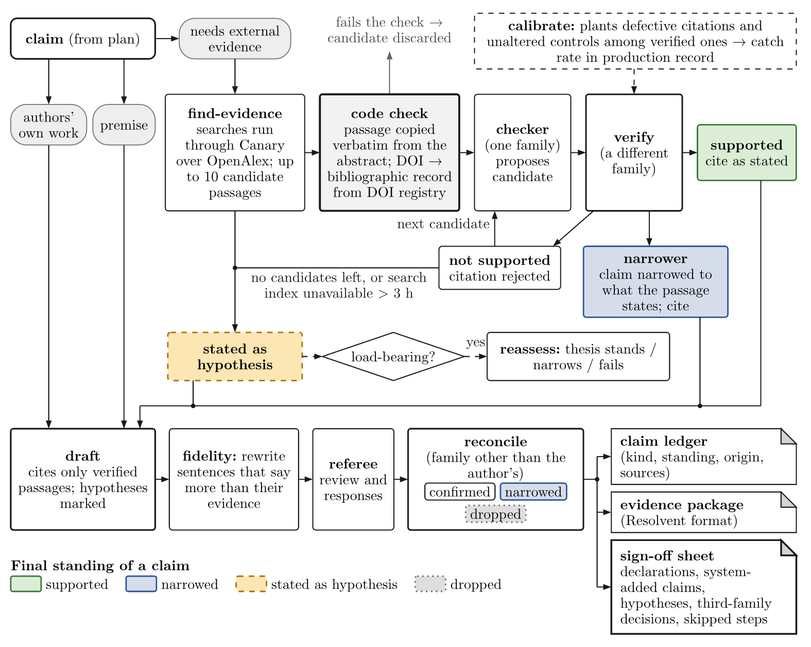

# Introduction

This paper considers how authors can develop a promising but rough idea into a pre-publication manuscript. Authors face the labour of manuscript preparation and the gatekeeping of academic publishing. We aim to reduce that labour while keeping manuscript claims within the scope of the evidence.

A design choice in manuscript automation is how to handle claims that exceed their evidence. One design puts pass/fail verification gates in the path of the draft. A claim that fails verification can halt the draft. Another design generates fluent prose without checking individual claims. In this design, an unsupported assertion can read as established fact. Section 2 reviews prior work on claim–citation verification. We do not assess how often existing tools follow either pattern. 

 Our thesis is that a compiler can use verification to set the scope of claims while agents from several model families carry a rough text seed through to a pre-publication manuscript. At drafting, when a claim needs external evidence, the compiler narrows the claim to what a verified source passage states, writes it as a hypothesis if no passage supports it, or holds it back when a person chooses citations. The compiler does not check claims about the authors' own work or premises against the literature. The authors' sign-off sheet lists every hypothesis and every claim that the system, rather than the seed, added. After drafting, fidelity checking and review revise prose that exceeds its claims or evidence, and reconciliation aligns the claim ledger with the final text. Judgments of support and wording rest on models. If a post-drafting step fails twice, the compiler skips it and lists the skip on the sign-off sheet, so an overclaiming sentence can remain in the completed manuscript until the authors act on that sheet. We call this approach scope-elastic compilation, and Section 3 defines it.

Galley implements this design in an editor. Our case study examines the autonomous run that produced this manuscript, in which no step waited for a person. The run took two inputs: the authors' text seed, which sets what the paper argues, and a description of galley generated from its ladder, seats and package metadata, which supplies how galley works.        

      

This paper makes the following contributions:

1. We define scope-elastic compilation, in which required behaviours carry the manuscript to completion and verification sets the scope of each claim rather than gating completion (Section 3).
2. We describe galley's ladder of 24 atomic behaviours, 7 required and 17 that can improve the paper but never stop it, and the role-pair rules that assign different model families across specific seat pairs: direction proposer and selector, citation checker and verifier, author and referee, author and ledger reconciler, and an adjudicator distinct from both author and referee (Section 4).  
3. We describe how evidence revises claims: code confirms that each cited passage is copied verbatim from the cited work's abstract, and a model family other than the proposer's judges whether the passage supports the claim, supports a narrower claim, or does not support it (Section 5). 
4. We describe cross-family referee review, optional human participation, and the claim ledger, evidence package and sign-off sheet that each run produces (Section 6). 
5. We report a case study of manuscript production with galley (Section 7).

# Related Work

We place galley among five strands of work: automated systems that write papers, verifiers of claim–citation alignment, evaluations of AI-generated papers, measurements of self-preference in LLM evaluators, and metascience on what distinguishes high-impact papers.

## Automated writing systems

Automated systems already carry research material to a finished paper. PaperOrchestra is a multi-agent framework for automated AI research paper writing that transforms unconstrained pre-writing materials into submission-ready LaTeX manuscripts, including literature synthesis and generated visuals [@song2026paperorchest]. The AI Scientist generates research ideas, writes code, runs experiments, writes a full scientific paper and evaluates it in a simulated review process [@lu2024scientist]. Multi-agent drafting and automated review therefore predate galley. The comparison set does not include retrieval-grounded long-form writing systems or interactive human–AI writing editors, and we do not propose galley's in-editor collaboration as new. We address a different question: what a compiler does with a claim that its evidence does not cover.

## Claim–citation verification

Misalignment between claims and their cited evidence is a common failure mode in reports generated by large language models [@sadeghi2026deepsciverif]. Even when retrieval and human guidance reduce ghost citations, AI-generated papers contain more unsupported claims, rely on front-section evidence and use citations more affirmatively [@oh2026show]. DeepSciVerify verifies scientific claim–citation alignment in two stages: it reasons over abstracts and escalates selectively to passage-level evidence [@sadeghi2026deepsciverif]. Galley does not propose claim–citation verification or retrieval-supported citation as a contribution. Galley's proposed contribution is the action it takes on a claim after each verdict. Galley verifies against less text than DeepSciVerify: code confirms that each passage is copied verbatim from the cited work's abstract, and no step escalates to the full text. A verifier from a family other than the checker's judges each passage against its claim. A supported claim keeps its scope, a claim the passage covers in part is narrowed to what the passage states, and a rejected citation gives way to the next candidate. A claim that no abstract supports, including one that only a full text would support, is stated as a hypothesis while manuscript preparation continues.

## Evaluating AI-generated papers

Evaluating and comparing the quality of AI-generated research papers remains an open challenge; a benchmarking protocol assesses such papers with an LLM-based automated peer-review system on originality, scientific rigour, clarity and significance [@ravideshik2026can]. That protocol evaluates papers after a system has generated them. Galley uses referees from several model families during production, and the author revises the manuscript in answer to their findings. 

## Self-preference in LLM evaluators

LLMs used as evaluators tend to rate their own outputs more favourably than outputs from other models [@chen2025beyond; @daneshjou2026judge]. The cited passages report a model's preference for its own outputs, not a preference among models of one family; separating families on a role pair excludes both. Galley addresses this risk on specific role pairs rather than across all contributions: it assigns different model families to direction proposer and selector, citation checker and verifier, author and referee, author and ledger reconciler, and an adjudicator distinct from both author and referee (Section 4). Outside those pairs, a family can evaluate material to which it contributed in an earlier role. Whether these role-pair rules reduce self-preference in galley remains an open question.

## Features of high-impact papers

An analysis of 17.9 million papers across all scientific fields suggested that the highest-impact papers are primarily grounded in exceptionally conventional combinations of prior work while also featuring an intrusion of unusual combinations [@uzzi2013atypical; @mukherjee2017atypical]. Findings of this kind motivate assessing an idea before writing it, but atypicality in this sense is a property of a finished reference list, which a seed does not yet have. Galley's review-idea behavior scores the idea on seven impact factors before drafting, and its reprofile behavior scores the finished paper. Neither behavior measures reference-combination atypicality, and the seven factors have not been validated as predictors of impact.

## Provenance records

Each run writes three provenance records alongside the manuscript. The claim ledger lists every claim with its kind, its standing, whether the seed or the system made it, and its sources. The evidence package holds the claims, the verbatim abstract passages that support them and their sources in the Resolvent format, and a cited work with a DOI takes its bibliographic record from the DOI registry. The production journal, with every stored prompt and answer, lets a rerun replay each step without calling a model. We present these records as outputs of galley's workflow and do not compare them with digital-library models of citation context or scholarly provenance.

## What is new

We state the novelty of galley as a hypothesis, because the abstract passages cited here summarize what each system does; they cannot show that no system, or no full paper of a cited system, combines the elements below. The comparison set is the closest prior systems whose abstracts we cite: PaperOrchestra and The AI Scientist for end-to-end writing, and DeepSciVerify for claim–citation verification. As far as we know, none of them combines four elements. The first is manuscript preparation that continues when an improver behavior fails and is skipped. The second is automatic narrowing or hedging of claims based on evidence that code checks against the cited source word for word. The third is cross-family verification, and the fourth is a human sign-off sheet. The novelty we propose lies in this combination, not in any one element. When a citation fails verification, the cited abstract passages of PaperOrchestra and The AI Scientist state no rule for the claim, and the passage cited for DeepSciVerify describes a verification pipeline, not a writer that revises the claim. In galley, the next candidate citation replaces a rejected one, and a claim left without verified evidence is stated as a hypothesis. The cited works establish multi-agent drafting, simulated review, automated paper evaluation and claim–citation verification, and post-hoc revision of language-model output outside scientific writing may anticipate the second element. Galley uses cross-family verification to adjust claim scope while manuscript preparation continues.

# Scope-Elastic Compilation

We define scope-elastic compilation as follows. A manuscript compiler reaches completion through a small set of required behaviours and makes each claim's scope, rather than completion, the object that verification acts on. When a claim exceeds its verified evidence, the compiler narrows it to what the evidence supports, gives it hypothesis standing, or lists it for human sign-off instead of halting the draft. Three levels of this definition must be kept apart. Claim standing records what each claim may assert; the compiler sets it from verification outcomes, and the sign-off sheet lists each claim stated as a hypothesis. Drafting instructions direct the `draft` model to write each claim at its standing. Code enforcement covers only citations: `draft` can cite only passages that passed verification. Whether each sentence stays within its claim's standing is a model judgment, which post-draft checks review but cannot guarantee. Galley is our manuscript compiler.

The required behaviours form the skeleton and determine completion through three states. A draft exists once `draft` has written every section. A package exists once `frame` has written the title and abstract and `typeset` has rendered the manuscript, the evidence package and the sign-off sheet. The paper is complete once `ready` marks it ready for submission, which it does when every gate holds on one revision, so the text and all its outputs come from that revision. Every other behaviour is an improver: it can improve the paper but never stop it, and one that fails twice is skipped with its effect recorded. Because `verify` is an improver, no gate depends on a verification result, so verification verdicts never block completion while claim scope varies; a model provider's usage limit longer than about six hours, for example, still pauses the run, which can then be resumed.

Claim scope is the extent of what a claim asserts. A claim is supported when its verified evidence covers its scope; a claim whose scope exceeds that evidence has three permitted outcomes. Narrowing reduces the claim's scope to what the verified evidence supports: the narrowed claim asserts nothing the original did not. A revised claim that asserts something new is a substitution, even when the passage supports it, and the definition does not permit it. For a hypothetical example, a claim that a method improves recall on every benchmark, matched to a passage reporting an improvement on one benchmark, narrows to an improvement on that benchmark; replacing it with the passage's statement about runtime would be substitution. Stating the claim as a hypothesis marks it as tentative. Listing the claim for sign-off leaves the final decision to human judgment. Until a person decides, the claim keeps narrowed or hypothesis standing, or, with citation choices on, is held back from the draft. At claim assignment, the definition excludes two other outcomes: halting the draft over failed verification, and assigning supported standing to a claim whose evidence does not cover it.

We interpret the first two outcomes in terms of academic hedging. In academic writing, hedging is a way writers moderate the strength of a claim and their commitment to it [@alshbeekat2025hedging]. In support of previous literature, that study concludes that hedging devices qualify writers' commitment, lessen the impact of their claims and convey probability. We treat narrowing as a reduction in claim strength because it limits what the claim asserts. Stating the claim as a hypothesis preserves its content and expresses a weaker commitment to its truth. 

Verification selects the outcome. When the verifier judges a passage narrower than its claim, the compiler narrows the claim to what the passage states. Whether the narrowed claim asserts nothing beyond the original rests on model judgment; code does not check it. When a claim ends without a supported passage, it takes hypothesis standing, `draft` is instructed to state it as a hypothesis, and the sign-off sheet lists it. In the autonomous setting, the authors sign off after the manuscript is complete. If a person turns citation choices on, each claim is instead held back from the draft until they pick a candidate source, let the system pick, or state it without a source; the dial can make load-bearing citations wait in the same way. 

Elasticity also extends beyond single claims. Some claims are load-bearing: the thesis depends on them. When a load-bearing claim ends without evidence, the `reassess` behaviour decides whether the thesis stands, narrows or fails. Because `reassess` is an improver, even a fail verdict does not stop the paper: the load-bearing claim takes hypothesis standing like any other claim without a supported passage, and the sign-off sheet lists it.

Post-draft improvers review the prose and its records but do not enforce scope. The `fidelity` behaviour rewrites drafted sentences that say more than their evidence. During review, the referee who raised a finding judges each author answer and its edits, while `adjudicate` settles findings at the answer cap and lists its decisions on the sign-off sheet. After review, `reconcile` runs in a family other than the author's to align the claim ledger, the evidence package and the sign-off sheet with the final text; it changes those records, not the prose. No required behaviour rechecks sentences or ledger entries after drafting. Code confirms that each cited passage appears verbatim in its source's abstract; passage support, sentence fidelity and ledger alignment are model judgments, and of these only the verifier's detection of planted defective citations is measured, by `calibrate`. A sentence that says more than its evidence, or a ledger entry that differs from the text, can therefore reach the completed manuscript in two ways. A post-draft improver that fails twice is skipped, and the sign-off sheet names the skipped step. A check that runs can miss the error, and nothing flags the miss. In both cases the error is left to the authors' review rather than to compiler enforcement. 

# Galley: Ladder, Scheduler and Seats

Galley turns one input into a manuscript. The input is a seed: a written text in which a person states an idea. Galley takes written text only, and spoken input is out of scope. With the dial set to autonomous, the person supplies only the seed and no step waits for a person. This section describes the ladder of behaviours, the scheduler, failure and outage handling, and seat assignments across model families. Section 5 follows a claim through the evidence behaviours, and Section 6 covers review.

## The ladder of behaviours

Galley breaks manuscript production into a ladder of 24 atomic behaviours. Seven are required behaviours, also called the skeleton: `extract`, `plan`, `outline`, `draft`, `frame`, `typeset` and `ready`. Together they make a paper exist. The other 17 behaviours are improvers. An improver can make the paper better but can never stop it.

The ladder orders the behaviours as follows. `extract` lists the seed's claims, the concern behind them, its stated contribution and its host field. Four improvers then aim the idea: `position` places it against its closest prior work, `review-idea` scores it, `reformulate` proposes new directions and `select-direction` chooses among them. `plan` sets the thesis and the claim graph, and `outline` sets the sections, word budgets and planned figures. Four improvers handle evidence: `find-evidence`, `verify`, `reassess` and `calibrate`. `draft` writes each section once its evidence is settled. The improvers `figure` and `fidelity` then draw the planned figures and check each drafted section against its claims. `frame` writes the title, abstract and keywords. Five improvers run review: `referee`, `close-round`, `respond`, `verify-disposition` and `adjudicate`. The improvers `reconcile` and `reprofile` then align the claim ledger with the final text and rescore the finished paper. `typeset` renders the outputs, and `ready` marks the paper ready for submission.

## Atomic behaviours and the scheduler

Galley takes the atomic-behaviour pattern from poise, our earlier tool for semi-autonomous software engineering. Each behaviour reads the paper's state, does one thing and writes its result. No behaviour knows what comes next. The scheduler determines the order of execution. The scheduler starts at the top of the ladder and returns to the top whenever work settles. The ladder order is therefore the order in which the scheduler considers behaviours, not a fixed sequence of steps.

After a later behaviour settles, the scheduler considers earlier behaviours again and runs any that are ready. Caps limit how often work repeats. In this run, review was capped at two referee rounds and at three answers per finding before a third family adjudicated it. A skipped improver still settles its part of the paper's state through its recorded effect, so the behaviours that wait on it can run. For example, `draft` writes a section once the evidence for its claims is settled. If `verify` fails twice, galley skips it, gives the affected claims hypothesis standing, lists the skip on the sign-off sheet, and instructs `draft` to state them as hypotheses.

Readiness ties the manuscript and its outputs to one revision, though the generated description of galley omits the individual gates and their predicates. `typeset` renders the outputs again whenever the text changes. `ready` marks the paper ready for submission only when every gate holds on one revision. Any later change to the text, from a referee answer or from a person's edit in the editor, makes a new revision on which every gate must hold again. Because improvers never stop the paper, no gate depends on a verification result. With the dial set to autonomous, no gate waits for the sign-off sheet, which lists the declarations, the claims the system added, the claims stated as hypotheses, the decisions a third family made and the skipped steps.

We built galley's behaviours one at a time. We wrote a behaviour, showed it working, and only then built the next, until the chain of working behaviours covered the full ladder.

## Failures and outages

The split between required behaviours and improvers decides how galley responds when a step fails. When an improver fails twice, galley skips it and records the effect. If the skipped improver leaves a claim without evidence, galley hedges the claim. Galley omits a figure when the improver that draws it fails twice. A skipped improver can change what the manuscript asserts and contains, but not whether it exists.

Galley limits how long it waits when a provider hits a usage limit or the search index becomes unavailable. When a model provider hits a usage limit, galley waits it out for up to about six hours without counting a failure; a longer limit pauses the run until it is resumed. When the search index is unavailable, galley waits for up to three hours. If the index remains unavailable after that wait, galley hedges the affected claims and manuscript production continues.

## Seats across model families

Galley assigns work to seats and assigns the seats to model families. The seats are author, checker, challenger, verifier, referee and adjudicator. In this run, Claude Opus 5.5 was the author, GPT-6.2 Sol the checker, and Gemini 4 Carbon the challenger and verifier.

Galley separates families through rules on specific role pairs. The checker proposes each citation, and the verifier, from another family, judges it. Referee seats go to families other than the author's and rotate between rounds. The referee who raised a finding judges the author's answer to it. Adjudication goes to the family that is neither the author's nor the referee's. The family that proposes new directions for the seed does not choose among them. After review, a family other than the author's reads the final text against every claim in the ledger. Galley does not track contribution provenance across all review assignments, so the separation holds for these pairs only. Outside them, a family can review work it contributed to: in this run, a referee seat from the GPT family could review citations that GPT-6.2 Sol proposed as checker.

## Challenging the seed and rescoring the paper

Galley challenges the seed before writing any part of the manuscript. The `review-idea` behaviour scores the idea on seven impact factors, names the weakest and gives a verdict: worth writing, reformulate, or no contribution. When the idea should be reframed, `reformulate` proposes three structurally different directions that preserve the seed's explicit commitments. In `select-direction`, a model family other than the proposer then selects the original idea or one of the three directions. If one of these improvers fails twice, galley skips it and continues manuscript production.

After review, `reprofile` scores the finished manuscript again. Both sets of scores are heuristic self-assessments made by models inside the run. They are not predictions of impact, and we do not treat them as evidence that this or any paper will have impact. Section 8 returns to this limit.

{#fig-fig1 width=95%}

# Evidence, Verification and Claim Scope

This section describes the path a claim takes from the search for its evidence to its standing in the claim ledger.  Verification and reconciliation can change the claim's scope. Verification sets a claim's standing as supported, narrowed, or hypothesis. Drafting instructions direct `draft` to match that standing, and reconciliation can later confirm, narrow, or drop the ledger entry.  

## Retrieval through Canary

The plan marks each claim as needing external evidence, as the authors' own work, or as a premise. Evidence search covers only the first kind. The labels are model judgments that no behaviour is assigned to check. A seed claim that needs outside support but is labelled otherwise skips search and verification, is stated as fact and does not reach the sign-off sheet, though a referee can still raise it. Claims of these two kinds that `plan` adds go to the sign-off sheet as claims the system added.  For each claim that needs evidence, `find-evidence` writes literature searches and runs them through Canary, the authors' search tool over the OpenAlex scholarly catalogue. From the abstracts the searches return, it selects up to ten candidate passages, each copied verbatim.

Retrieval stays in Canary by design. Galley writes the queries and reads the abstracts that Canary returns. This division keeps galley to one task, manuscript production, and leaves retrieval to a separate tool.

## Verbatim passages and registry records

Code, not a model, establishes where every cited passage comes from and, for works with a DOI, where the bibliographic record comes from. Before citation, code checks that the passage reproduces text from the cited work's abstract verbatim. The draft cannot cite a passage that fails this check. When the cited work has a DOI, its bibliographic record comes from the DOI registry and not from model output. A citation therefore cannot rest on an invented passage, and a cited work with a DOI cannot carry an invented bibliographic record. The registry check does not cover cited works without a DOI.

This check settles provenance, not relevance. A verbatim passage from a real work can still fail to support the claim it is attached to. Judging that fit is the verifier's task. Because every passage comes from an abstract, verification judges claims against abstracts and not against full texts. 

## Cross-family verdicts

The checker and verifier come from different model families. The checker proposes a candidate passage. The verifier, from a different family, judges it against its claim and returns one of three verdicts. A verdict of *supported* means the passage supports the claim, and the citation stands. When the verdict is *narrower*, galley narrows the claim to what the passage states. When the verdict is *not supported*, galley rejects the citation and tries the next candidate passage.

Narrowing reduces what a claim asserts until it matches a verified passage.  When the verifier rejects every candidate for a claim, the claim ends without verified evidence and takes hypothesis standing. Galley lists the claim on the sign-off sheet and instructs `draft` to state it as a hypothesis. A *not supported* verdict covers passages that are silent on a claim and passages that contradict it, so hypothesis standing does not show which of the two the verifier found. 

The split between checker and verifier is one of the role-pair separation rules in Section 4: the family that proposes a candidate passage does not act as verifier for that passage. This run does not show whether cross-family verification catches more defects than same-family verification. 

## Drafting and fidelity

At drafting, code enforces citation selection while instructions govern how prose reflects claim standing. The `draft` behaviour writes each section from its claims, their standings, and any verified passages. Code restricts `draft` to citing only passages that passed verification. Drafting instructions direct `draft` to keep each claim within its standing and to state any claim with hypothesis standing as a hypothesis rather than as established fact. Code does not check whether the drafted prose follows those instructions. 

Post-draft checking reviews sentence scope through model judgment rather than code enforcement. A drafted sentence can still say more than its claim or evidence. The `fidelity` improver checks each drafted section and rewrites sentences that exceed their claim's standing or verified passage, but it can miss overclaims. Claims marked as the authors' own work or as premises carry no passage, so `fidelity` checks their sentences against the planned claim alone. If `fidelity` fails twice, galley skips it and lists the skipped check on the sign-off sheet for author review.

## Calibration of the verifier

Galley tests the verifier against planted defects on each run, and the production record reports only the resulting catch count. The `calibrate` behaviour plants defective citations among the verified ones, mixes in unaltered controls, and measures how many of the planted defects the verifier catches. The production record omits the number of controls and the verdicts on them. The specification of galley's mechanics generated for this manuscript also omits how `calibrate` constructs planted defects and which outcomes count as a catch.

The reported count measures sensitivity to a run's planted defects, not specificity or verifier reliability. A verifier that rejected every candidate would also catch every planted defect, and without control outcomes the verifier's false-rejection rate remains unknown. The count also covers only one verifier on the claims of one run, not other seeds or fields. This run does not show whether the count predicts how often the verifier catches citation errors outside the planted set.

## Reconciling the ledger with the text

The `reconcile` improver runs only after review to align the claim ledger with the final text, and its outcome rests on model judgment. Drafting and revisions during review can narrow or change the prose while the ledger still holds earlier wording. Referees therefore read an unreconciled ledger and do not check `reconcile` verdicts. Once review finishes, a family other than the author's reads the final text against every claim in the ledger. For each claim, it confirms the ledger entry, narrows the entry to the text's wording, or drops it as no longer stated. The claim ledger, the evidence package and the sign-off sheet then reflect those verdicts rather than a code-verified match with the prose. If `reconcile` fails twice, galley skips it, names the skipped step on the sign-off sheet and leaves unaligned ledger entries in place until the authors sign off.

Each reconcile verdict can be audited. Galley stores every prompt and answer, including each verdict, in the paper's folder alongside the production journal, and a rerun replays them without calling a model. The manuscript ends with the claim ledger, which gives each claim's standing and sources, and with a production record generated from the same journal. A reader can trace each confirmed or narrowed claim from its ledger entry to the verdict that set its standing. The trace for a dropped claim starts from the stored reconcile verdict that dropped it.

{#fig-fig2 width=95%}

# Review, Human Participation and the Manuscript Package

The referee seats read the draft manuscript and raise findings. The author answers each material finding. A third model family adjudicates any material finding that remains disputed at the answer cap. This section describes that loop, the optional controls through which a person can take part, and the package that each run writes.

## Cross-family referee seats

Four referee seats review the manuscript: methods, the host field, citations and the desk editor. Each seat is drawn from a model family other than the author's, and the seats rotate between those families from one round to the next. Every seat reads the whole manuscript. Each seat specifies a severity and a requested decision for every finding it raises.

## The capped answer-and-judge loop

The author answers each material finding in one of four forms. The author can fix the finding and give the exact edits. The author can also rebut the finding, state it as a limitation, or mark it as needing evidence. A finding that needs evidence prompts a new claim. That claim goes through search and verification.

The referee who raised a finding judges the author's answer. In this run, the cap was three author answers per finding. A finding still disputed at the cap goes to adjudication. A third model family settles the finding. Each decision made this way also appears on the sign-off sheet described below.

Each family uses its own command-line client without tools and returns answers that conform to a strict JSON schema. Galley stores every prompt and answer. A rerun replays the stored answers without calling a model. The same store gives people the full provenance of each finding, answer, judgement and adjudication.

## Optional human participation

Galley offers optional controls for human participation. They can edit the document directly or comment anywhere in it. A direct edit becomes that person's revision on the next run.

Each comment becomes a thread with one of three ownership settings. By default the agents take it over. The person keeps a thread marked `@humans`. The person and the agents share a thread marked `@both`. In a shared thread, the agents' changes arrive as proposed edits placed in the document. This follows the side-chat pattern of poise, the authors' editor. The person accepts or declines each proposed edit and stays in charge of the text.

Citation selection is automatic by default. With citation choices turned on, each claim waits for the person. The person chooses among the claim's candidate sources (a, b, c), lets the system pick, or states the claim without a source. Each candidate is a passage that code confirms is copied verbatim from the cited work's abstract. Whoever picks it, the verifier, a family other than the checker's, judges the passage against the claim and can narrow the claim to what the passage states. A claim stated without a source has no verified evidence, so the draft states it as a hypothesis and the sign-off sheet lists it. On every path, the claim ledger records the claim's standing and origin.

The dial controls which steps wait for a person. It can make load-bearing citations and critical answers wait, or it can make every answer wait.

## The manuscript package

Galley 0.1.0 is open source under the MIT licence, with source at https://github.com/autonomio/galley. From a text seed alone, it produces a complete manuscript package: a PDF, a line-numbered review PDF, LaTeX, Word, the editor document, an evidence package and a sign-off sheet. It also writes a production journal for each run.

Each manuscript ends with its claim ledger and a production record. The claim ledger lists every claim with its kind, its standing, its origin in the seed or the system, and its sources. Galley generates the production record from the run's journal.

Each paper also gets its own evidence package in the Resolvent format, which the run writes as part of the manuscript package. The package holds the reconciled claims, the bibliographic record of each cited work, and the verbatim abstract passage behind each citation, which galley finds through Canary's search over OpenAlex. Typesetting renders each citation key as a reference-list entry from the cited work's bibliographic record; when the work has a DOI, that record and its DOI come from the DOI registry. From the manuscript alone, a reader can use a citation key to find its reference entry and every claim-ledger entry that lists the cited work among its sources (Appendix A). When one work supports several claims, the reader identifies the relevant ledger entry from the wording of the citing sentence, then looks up the cited work externally to read the claim against its abstract. The evidence package adds the accepted passage itself, paired with its claim and record.

The sign-off sheet lists what only the authors can decide: declarations, claims the system added, claims stated as hypotheses, decisions a third family made, and skipped steps.

Together, the claim ledger, the evidence package, the production record and the sign-off sheet state what the manuscript claims and on what evidence. They also record how the run reached the text and what the authors still have to decide.

{#fig-fig3 width=95%}

# Case Study: The Run That Produced This Manuscript

## Run and method

This manuscript is galley's first production. Galley compiled it from the authors' seed in one autonomous run, set for two referee rounds and a preprint venue.   Galley generated a specification of its mechanics from its code, seats and package metadata. The models drafted the sections that describe galley from that specification.

We evaluate scope-elastic compilation in an instrumented case study of this run; the same run wrote the case study. From the run's production record we report how many claims ended narrowed or stated as hypotheses, how many planted defects the verifier caught, and how the run resolved referee findings. The claim ledger at the end of the manuscript gives the kind and standing of every claim it keeps, including claims that ended supported.

No model supplied any of these numbers. Code generates the record from the run's journal and fills it in each time the text is typeset, so the table states the run at the revision it accompanies. Each typeset writes the PDF, a line-numbered review PDF, LaTeX, Word, the editor document, the evidence package in the Resolvent format and the sign-off sheet. The paper's folder also keeps the production journal and every prompt and answer.    

## Production record

| Measure | Value |
|:----------------------------------------------------------|----------------------:|
| Wall-clock time from seed to the typeset of this revision (hours) | 2.8 |
| Model calls, total | 121 |
| Model calls answered by Claude Opus 5.5 | 59 |
| Model calls answered by GPT-6.2 Sol | 30 |
| Model calls answered by Gemini 4 Carbon | 32 |
| Input tokens (millions) | 2.6 |
| Output tokens (thousands) | 1751 |
| Distinct behaviours that ran | 23 |
| Claims in the claim ledger at this revision | 38 |
| Claims from the seed | 20 |
| Claims added by the system | 18 |
| Claims narrowed to what their evidence supports | 6 |
| Claims stated as hypotheses (no external evidence) | 3 |
| Candidate works screened for evidence | 180 |
| Citations verified against their passages | 11 |
| Proposed citations rejected by the verifier | 11 |
| Planted defects caught by the checks (caught of planted) | 6 of 6 |
| Referee rounds | 2 |
| Referee findings, total | 81 |
| Material or critical findings | 65 |
| Material or critical findings resolved | 65 |
| Findings settled by a third model family | 16 |

Table: Production record of the run that compiled this manuscript, filled in by the typeset of this revision. Values state a review-stage snapshot that had not reached ready; claim rows give claim-ledger statuses, provisional until reconcile has run. 

## Reading the record

The claim rows count standings in the claim ledger at this revision, not sentences in the prose. The narrowed row counts ledger claims reduced to what their verified evidence supports. The hypothesis row counts ledger claims that took hypothesis standing after search and verification ended without verified evidence; drafting instructions direct `draft` to state such claims as hypotheses, and post-draft improvers review the prose without guaranteeing it. Reconcile aligns the ledger with the final text only after review, so before it runs these are provisional ledger statuses, and the claim rows can include claims the prose no longer states. Narrowing and hedging act on claims marked as needing external evidence. Premises and claims that state the authors' own work, including the load-bearing claims of this section, go through no literature search or citation verification; the fidelity and reconcile behaviours check the text against them. The claims outside the two rows are therefore not all externally verified. Each claim with external support rests on at least one verified citation, so the verified row bounds how many claims ended supported or narrowed. The table has no rows for supported, own-work or dropped claims. The claim ledger gives the kind and standing of each claim it keeps, and the paper's folder stores every reconcile answer, including any decision to drop a claim as no longer stated.  

   

The behaviours row counts the distinct behaviours of the 24-behaviour ladder that ran. The record neither names them nor lists skipped steps: the production journal names each behaviour in order, and the sign-off sheet lists each skipped step. The manuscript and production record establish at least seventeen behaviours that ran, including `adjudicate`, which settled findings referred to a third model family. The skeleton behaviours extract, plan, outline and draft produced the sections under review, frame wrote the title and abstract, and typeset filled in this table. The run chose a reformulated direction before planning: review-idea gave the verdict to reformulate, reformulate proposed three directions, and select-direction chose one. The record's rows show that find-evidence, verify, calibrate, referee, close-round and respond ran, and verify-disposition ran when referees judged the answers to their findings. The production journal names any others. A behaviour can be absent from the count for three reasons. An improver that fails twice is skipped. An improver whose trigger never occurs does not run and is not a skip: reassess, for example, runs only when a load-bearing claim ends without evidence. A behaviour the run had not reached when the record was last filled in is also absent. Reconcile, reprofile and ready run only after review, so a record filled in while review continues counts none of them. Ready marks a revision only after that revision is typeset, so no filled-in record counts it. The table and every revision a referee read therefore state a review-stage snapshot: a complete typeset manuscript that had not reached ready, the terminal state that marks the paper ready for submission once every gate holds on one revision.   

The screened row counts candidate works across all searched claims. The verified row counts citations the verifier judged supported or narrower, and the rejected row counts proposed citations it judged not supported. A narrowed claim keeps its verified citation, so narrowed claims fall among those the verified citations support and are not additional to them.

The calibration row reports how many planted defects the checks caught in this run only. It does not measure verification in other runs or on defect types that were not planted.

The review rows give the milestone the record reached: 2 referee rounds, with 65 of 65 material or critical findings resolved and 16 settled by a third model family. The sign-off sheet lists each third-family decision for the authors. 

On its own the table cannot show that no sentence of the final text goes beyond its evidence. These values describe one run of one seed and the behaviours that ran in it. They therefore support no claim that galley generalises to other seeds or outperforms other systems. 

# Limitations

The evidence this paper presents has clear limits. 

The case study rests on a single self-referential run. Galley compiled this manuscript about its own operation, so most of its claims, including the load-bearing claims, describe the authors' own system. Galley sends such claims to neither literature search nor verification. External verification was therefore tested only on the minority of claims that need outside evidence, and the run did not exercise the step that reassesses the thesis when a load-bearing claim ends without evidence. The run also gave the models, separately from the text seed, a description of galley generated from its own ladder, seats and package metadata, and the account of how galley works rests on it. An author describing their own method from a rough seed has no such generated description, so this run does not test how faithfully galley plans and drafts own-work claims from a seed alone. The claim ledger gives each claim's kind and standing. The case study also provides no estimate of variation across runs, seeds or host fields.

The run used no external seeds.  A seed written by someone else, on a different topic, may produce different claim standings. We have not tested this.

 We did not run a single-family configuration, in which one model family fills every seat, and we did not compare galley with prior systems. The case study therefore cannot show that cross-family seats catch more overclaims than one family would, or that galley does better than earlier tools. 

We used no human-in-the-loop controls in this run. Galley ran with the dial at autonomous and selected citations automatically.  This run did not test whether these controls change claim standings or how much author effort they require.

Search ran through Canary over OpenAlex, and verification used only abstracts. Verification can therefore confirm no more than an abstract states, and the full text of a cited work may qualify a claim in ways this run did not check. Two further limits follow. A prior system that OpenAlex does not yet index, or indexes without an abstract, cannot be cited; galley then leaves it uncited rather than invent a reference, unless an author supplies a source. Each verified passage also comes from a single work, so no single abstract can confirm a claim about what a set of prior systems lacks; galley states such a claim as a hypothesis.

  

'Ready for submission' has a narrow meaning. The designation means that every gate held on one revision, and the generated description of galley omits the individual gates and their predicates. The designation does not mean the claims are correct or that the paper will have impact.   

# What This Opens

Future studies could address six questions about scope-elastic compilation.

1. **A scope-fidelity benchmark.** The benchmark's seeds would contain planted overclaims, whose correct, narrower scope is known in advance, and supported controls, which already match their evidence. A final text would fail an item when it states anything beyond the known scope as established fact, and would lose credit when it drops or weakens supported content. Narrowings, explicit hypotheses and sign-off referrals would be reported separately, and weakened controls would measure unnecessary hedging. The benchmark would use the same seeds across systems.

2. **Abstract-versus-full-text drift.** We do not know how often a claim supported or narrowed against an abstract would receive a different verdict against the full text.

3. **Cross-family versus same-family verification.** A replay study could keep a run's stored claims, rerun the checker seat with models from several families, and hold each checker's candidate passages and `calibrate` items fixed while verifiers from the checker's family and from other families judge them. For each checker–verifier pairing it would report the share of planted defects caught and the share of unaltered controls rejected, so that a verifier cannot score well by rejecting more. This crossed design, with more than one model per family where available, would show whether a difference comes from family separation or from the particular models.

4. **Mixed-initiative sign-off.** A study could compare autonomous runs with runs that allow human input. Studies with authors could measure which items on the sign-off sheet people change. They could also test whether routing load-bearing citations to a person changes the final standings.

5. **Auditing human-written papers.** If a human-written paper were paired with a claim ledger recording each claim's kind, standing, origin and sources, the same `verify` and `reconcile` passes could audit text that galley did not write.

6. **Pre-writing reformulation across external seeds.** A study could apply `review-idea` and `reformulate` to seeds from outside authors. The study could ask those authors whether they prefer the original or reformulated directions. The study could also use `review-idea` and `reprofile` to generate heuristic assessments for comparison with assessments by outside readers. Such a study would measure agreement, not impact.

We release galley as open-source software: \@autonomio/galley 0.1.0, under the MIT licence, at <https://github.com/autonomio/galley>.

# Appendix A: Claim ledger {.unnumbered}

Every claim of the final argument, as the claim ledger holds it: its kind, its standing, where it came from, and the verified sources it rests on. Identifiers are the ledger's own and need not be consecutive.

- **C1** (background; narrowed to its evidence; from the seed) [@mukherjee2017atypical]. A metascience study suggests that papers with exceptional impact differ from other papers by featuring atypical combinations of prior work set inside an otherwise conventional body of references.
- **C3** (contribution, load-bearing; the authors' own work; from the seed). Galley is a manuscript compiler built into an editor. Agents from several model families carry a text seed through to a pre-publication manuscript, applying to academic writing the semi-autonomous pattern that poise applies to software engineering.
- **C4** (method; the authors' own work; from the seed). Galley takes written text as its seed. Spoken input is out of scope.
- **C5** (contribution, load-bearing; the authors' own work; from the seed). From a text seed alone, galley produces a complete manuscript package: a PDF, a line-numbered review PDF, LaTeX, Word, the editor document, an evidence package and a sign-off sheet.
- **C6** (method; the authors' own work; from the seed). Before anything is written, galley challenges the seed. One behaviour scores it on seven impact factors and names the weakest. Another proposes three structurally different directions that keep the seed's explicit commitments. A family other than the proposer then picks the original idea or one of the directions. After review, the finished paper is scored again. These scores are heuristic self-assessments, not predictions of impact.
- **C7** (method, load-bearing; the authors' own work; from the seed). For each claim the plan marks as needing external evidence, galley writes literature searches, runs them through Canary over OpenAlex, and selects up to ten passages copied verbatim from the returned abstracts. Retrieval stays in Canary so galley handles manuscript production.
- **C10** (contribution, load-bearing; the authors' own work; from the seed). Each paper gets its own evidence package in the Resolvent format (claims, evidence, sources). It ends with a claim ledger (every claim's kind, standing, origin in the seed or the system, and sources) and a production record generated from the run's journal. A sign-off sheet lists what only the authors can decide: declarations, claims the system added, claims stated as hypotheses, decisions a third family made, and skipped steps.
- **C11** (method; the authors' own work; from the seed). Referee seats for methods, the host field, citations and the desk editor are drawn from families other than the author's and rotated between rounds. They review the whole manuscript and raise findings, each with a severity and the decision it asks for.
- **C12** (method; the authors' own work; from the seed). Auto-fix is a capped loop. The author answers each material finding as fixed (with exact edits), rebutted, stated as a limitation, or needing evidence; in the last case a new claim goes through search and verification. The referee who raised the finding judges the answer. After a set number of answers (three in this run), a third family adjudicates. Each family runs through its own command-line client with no tools, answering in a strict JSON schema. Every prompt and answer is stored, so a rerun replays the process without calling a model and people have its full provenance.
- **C14** (method; the authors' own work; from the seed). In a thread shared with the agents (\@both), agent changes arrive as proposed edits placed in the document, following the side-chat pattern of the authors' poise editor. The person accepts or declines each one and stays in charge.
- **C15** (method; the authors' own work; from the seed). Citation selection is automatic by default. With citation choices turned on, each claim waits for the person to choose among its candidate sources (a, b, c), let the system pick, or state the claim without a source.
- **C17** (method; the authors' own work; from the seed). A person can comment anywhere in the document or edit it directly. Edits become that person's revision on the next run. Each comment becomes a thread that agents take over by default, that the person keeps (\@humans), or that both share (\@both). A dial can make load-bearing citations and critical answers, or every answer, wait for the person.
- **C18** (method, load-bearing; the authors' own work; from the seed). Galley separates model families for the direction proposer and selector, citation checker and verifier, author and referee, and author and ledger reconciler. The adjudicator comes from a family distinct from both the author's and the referee's. Outside these pairings, a family can review work it contributed to. In this run, Claude Opus 5.5 was the author, GPT-6.2 Sol the checker, and Gemini 4 Carbon the challenger and verifier.
- **C19** (method; the authors' own work; from the seed). Galley takes the atomic-behaviour pattern from poise, the authors' earlier tool for semi-autonomous software engineering. Each behaviour reads the paper's state, does one thing and writes its result. A scheduler rescans the ladder from the top whenever anything settles, so no behaviour knows what comes next.
- **C20** (contribution, load-bearing; the authors' own work; from the seed). Galley breaks manuscript production into a ladder of 24 atomic behaviours, 7 required and 17 improvers. With the dial set to autonomous, the person supplies only the seed text and no step waits for a person.
- **C21** (method, load-bearing; the authors' own work; from the seed). Required skeleton behaviours (extract, plan, outline, draft, frame, typeset, ready) make a paper exist. Every other behaviour is an improver that can make the paper better but can never stop it. An improver that fails twice is skipped and its effect is recorded: a claim without evidence is hedged, a figure is left out. A provider usage limit is waited out for up to about six hours. An unavailable search index is waited for up to three hours, after which its claims are hedged.
- **C24** (method; the authors' own work; from the seed). The authors built galley's behaviours one at a time, showing each one working before building the next, until the chain of working behaviours covered the full ladder.
- **C25** (contribution; the authors' own work; from the seed). Galley is released as open-source software: \@autonomio/galley 0.1.0, under the MIT licence, at https://github.com/autonomio/galley.
- **C26** (contribution, load-bearing; the authors' own work; from the seed). This manuscript is galley's first production, compiled in one autonomous run set for two referee rounds and a preprint venue. The run used the authors' seed and a separate specification generated from galley's code, seats and package metadata. The models drafted the account of galley's mechanics from that specification.
- **C27** (method, load-bearing; the authors' own work; from the seed). We evaluate scope-elastic compilation in an instrumented case study of the run. The review-stage production record reports provisional counts of ledger claims narrowed or given hypothesis standing, the number of planted defects the verifier caught, and how referee findings were resolved. The claim ledger gives the standing of each claim it keeps, and the sign-off sheet lists skipped steps.
- **C28** (background; hypothesis: no verified evidence; added by the system). PaperOrchestra is a multi-agent framework that turns unconstrained pre-writing materials into submission-ready LaTeX research manuscripts.
- **C29** (background; supported; added by the system) [@sadeghi2026deepsciverif; @oh2026show]. Claim–citation alignment is still a reliability concern in AI-assisted scientific writing, and dedicated verifiers such as DeepSciVerify check whether cited sources support the claims they are attached to.
- **C30** (background; narrowed to its evidence; added by the system) [@ravideshik2026can]. Evaluating the quality of AI-generated research papers remains an open challenge. A benchmarking protocol assesses such papers using LLM-based automated peer review.
- **C31** (background; supported; added by the system) [@chen2025beyond; @daneshjou2026judge]. LLMs used as evaluators tend to rate their own outputs more favourably than outputs from other models.
- **C33** (background; narrowed to its evidence; added by the system) [@alshbeekat2025hedging]. In academic writing, hedging is a way writers moderate the strength of a claim and their commitment to it.
- **C34** (contribution, load-bearing; the authors' own work; added by the system). Scope-elastic compilation uses required behaviours to carry the manuscript to completion while verification sets the standing of claims marked as needing external evidence. A claim that exceeds its verified evidence is narrowed, given hypothesis standing, or listed for human sign-off. Failed verification does not halt the draft. With citation choices on, a claim can be held back pending a person's decision. Code enforces citation eligibility, while keeping prose within a claim's standing depends on drafting instructions and model judgments.
- **C35** (method, load-bearing; the authors' own work; added by the system). Code confirms that every cited passage is copied verbatim from the cited work's abstract. A citation cannot rest on a model-invented passage. For works with a DOI, the bibliographic record comes from the DOI registry, which prevents a model-invented record for those works.
- **C36** (method, load-bearing; the authors' own work; added by the system). The checker proposes a candidate passage. A verifier from a different family then judges it against its claim as supported, narrower (the claim is narrowed to what the passage states) or not supported (the citation is rejected and the next candidate is tried).
- **C37** (method, load-bearing; the authors' own work; added by the system). Code restricts the draft to verified passages, and drafting instructions direct it to write claims with hypothesis standing as hypotheses. The fidelity behaviour checks drafted sections and rewrites sentences that exceed their claim's standing or verified evidence. It can miss overclaims and is skipped after two failures.
- **C38** (method; the authors' own work; added by the system). When a load-bearing claim ends without evidence, a reassess behaviour decides whether the thesis stands, narrows or fails. Elasticity therefore applies to the thesis as well as to single claims.
- **C39** (method; the authors' own work; added by the system). A calibration behaviour mixes defective citations and unaltered controls among verified citations. The production record reports how many planted defects the verifier caught in that run. The count measures sensitivity to those planted defects.
- **C40** (method, load-bearing; the authors' own work; added by the system). After review, a family other than the author's reads the final text against each claim and confirms, narrows, or drops its ledger entry. The ledger, evidence package and sign-off sheet reflect those model judgments. If reconciliation fails twice, the sign-off sheet records the skipped step and unaligned ledger entries remain pending author sign-off.
- **C41** (method; the authors' own work; added by the system). The evidence has clear limits. It is a single self-referential run with no external seeds and no single-family or prior-system baselines. The human-in-the-loop controls were not used (dial autonomous, citations automatic). Verification used abstracts only, so it can confirm no more than an abstract states. 'Ready for submission' means every gate held on one revision. It does not mean the claims are correct or that the paper will have impact.
- **C42** (novelty; hypothesis: no verified evidence; added by the system). Based on the cited abstracts, we hypothesize that PaperOrchestra, The AI Scientist and DeepSciVerify each lack the combination of manuscript preparation that continues when an improver fails and is skipped, automatic narrowing or hedging of claims based on code-confirmed verbatim evidence, cross-family verification, and a human sign-off sheet. The proposed novelty is the combination. Earlier work established multi-agent drafting and automated review.
- **C43** (background; narrowed to its evidence; added by the system) [@song2026paperorchest]. PaperOrchestra is a multi-agent framework that turns pre-writing materials into submission-ready research manuscripts.
- **C44** (background; narrowed to its evidence; added by the system) [@lu2024scientist]. The AI Scientist is an automated system that generates research ideas, writes code, runs experiments, writes a full scientific paper and evaluates it in a simulated review process.
- **C45** (background; narrowed to its evidence; added by the system) [@uzzi2013atypical; @mukherjee2017atypical]. An analysis of 17.9 million papers across all scientific fields suggested that the highest-impact papers are primarily grounded in exceptionally conventional combinations of prior work while also featuring an intrusion of unusual combinations.
- **C47** (background; hypothesis: no verified evidence; added by the system). In scientific text generated by large language models, claims that their cited sources do not support remain a common failure mode, even when retrieval reduces fabricated citations.

# Use of AI and production record {.unnumbered}

This manuscript was produced with galley 0.1.0 (MIT licence, https://github.com/autonomio/galley) from a seed text written by the author. Claude Opus 5.5 extracted the seed's claims, planned the argument, drafted every section and answered the referees. GPT-6.2 Sol wrote the literature searches, selected candidate passages and checked each section against its claims. Gemini 4 Carbon challenged the idea before drafting and verified every citation against the passage it rests on. Referee reports came from GPT-6.2 Sol and Gemini 4 Carbon, never from the family that drafted the text, and each answer to a material finding was verified by the referee family that raised it. Literature search ran through Canary over OpenAlex; bibliographic records come from the DOI registries. No model reviewed its own work. The production journal that accompanies this manuscript records every step, model call, verdict and decision with its time, and the evidence package holds each claim with the verbatim passage and verdict behind every citation.

| Production record | |
|---|---|
| Model calls | 121 (Claude 59, GPT 30, Gemini 32) |
| Tokens | 2.6 M in, 1751 k out |
| Claims | 38 (20 from the seed, 18 added; 6 narrowed; 3 stated as hypotheses) |
| Works screened | 180 |
| Citations | 11 verified, 11 rejected |
| Referee findings | 81 (65 material or critical; 65 resolved; 16 adjudicated) over 2 round(s) |
| Planted-defect check | 6 of 6 planted defects caught by the citation verifier |

# Data and code availability {.unnumbered}

galley's source code, including the behaviors that produced this manuscript, is available under the MIT licence at https://github.com/autonomio/galley. Every claim in this manuscript, the evidence it rests on and the verbatim passages of its sources are available as an evidence package accompanying it (claims, evidence and sources in the Resolvent format).

# Competing interests {.unnumbered}

To be declared by the author.

# Funding {.unnumbered}

To be declared by the author.

# References {.unnumbered}

::: {#refs}
:::
